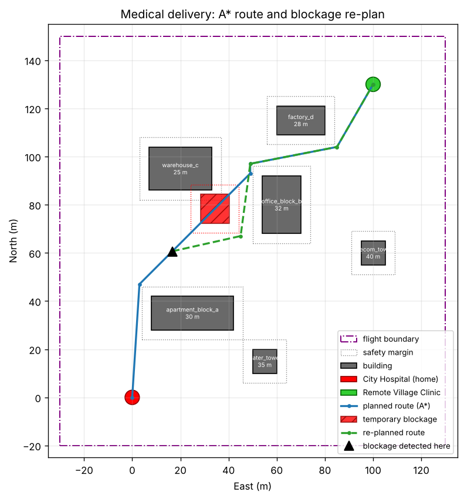

# Medical Package Delivery Drone (CS655 Drone Technologies, Q8)

**Problem statement:** simulate a drone delivering a medical package to a remote location while avoiding obstacles and handling a temporary route blockage.

A quadcopter (ArduPilot SITL) takes off from the **City Hospital** and flies an **A\*** route around six buildings to the **Remote Village Clinic**. It lands to deliver the package and then flies back. During the outbound flight, a **temporary blockage** (for example a crane, a fallen tree or a temporary no-fly zone) appears on the route. The drone handles it like this:

1. It detects the blockage with a simulated forward-looking range sensor, 25 m ahead.
2. It stops and **hovers** (HOLD).
3. It **waits** up to 20 s for the route to clear:
   - **If it clears in time,** the drone resumes the original route.
   - **If it's still blocked,** the drone re-plans a detour with A\* and continues.

The return leg avoids the blockage too if it is still there. A geofence (circle plus maximum altitude) and an RTL altitude above all buildings keep the flight inside safe boundaries.

| Scenario flag | What happens |
|---|---|
| `--scenario long` (default) | The blockage outlasts the 20 s wait, so the drone **re-plans** around it. |
| `--scenario short` | The blockage clears after 8 s, so the drone **resumes** the original route. |
| `--scenario none` | No blockage; a plain obstacle-avoiding delivery. |



---

## Tools and platform
| Component | Version / notes |
|---|---|
| OS | Ubuntu 22.04 LTS. Native, or a VMware Workstation VM with "Accelerate 3D graphics" turned on |
| Simulator (3D world) | Gazebo Harmonic (gz-sim 8) |
| Flight controller | ArduPilot ArduCopter SITL, with the `ardupilot_gazebo` plugin |
| Ground control station | QGroundControl 5.0.8 (optional, for the map and telemetry) |
| Middleware | ROS2 Humble + `ros_gz` bridge, installed per the course guide (optional for this project) |
| Mission code | Python 3: `pymavlink` (MAVLink), `matplotlib` (maps) |

## Repository layout
```
config/mission.json        <- the whole scenario: hospital, village, buildings, blockage, speeds, fence
scripts/planner.py         <- occupancy grid + A* + line-of-sight path simplification
scripts/mission.py         <- MAVLink mission state machine (takeoff, follow path, hold, re-plan, land, return)
scripts/live_map.py        <- live 2-D map of the mission (reads logs/state.json)
scripts/generate_world.py  <- builds the Gazebo world and the blockage model from config/mission.json
scripts/viz.py             <- shared plotting helpers
worlds/medical_delivery.sdf  (generated)    models/blockage.sdf  (generated)
tests/test_mission.py      <- offline test of the mission logic with a simulated drone (no SITL needed)
docs/report.md             <- report draft (team, design, tools, contributions)
logs/                      <- created at run time: flight_log.csv, events.txt, flight_map.png
```

---

## 1. One-time setup
Follow the course install guide (Steps 1–7) on Ubuntu 22.04: ROS2 Humble, Gazebo Harmonic, ArduPilot SITL, the `ardupilot_gazebo` plugin and QGroundControl. Check that the guide's own test flight (`iris_runway.sdf` + `sim_vehicle.py`) works first.

Then get this project and its Python packages. Run each command on its own:
```bash
cd ~ && git clone https://github.com/gusfring3369/Drone.git && cd Drone
```
```bash
sudo apt install python3-matplotlib -y
```
```bash
python3 -c "import pymavlink, matplotlib; print('python deps ok')"
```
`pymavlink` is installed by ArduPilot's `install-prereqs-ubuntu.sh`. If the last command fails, install both packages with pip:
```bash
python3 -m pip install --user pymavlink matplotlib
```

Optional: run the offline checks. These work on any computer, with no simulator needed.
```bash
python3 scripts/planner.py
```
```bash
python3 tests/test_mission.py
```
The first prints the route and saves `docs/plan_preview.png`. The second should print `PASS` for the scenarios `none`, `short` and `long`.

## 2. Running the simulation
Open **5 terminals**, each starting in `~/Drone`, and start them in this order.

**Terminal 1: Gazebo world.** Hospital, village, buildings and the drone.
```bash
cd ~/Drone && gz sim -v4 -r worlds/medical_delivery.sdf --render-engine ogre
```
Drop `--render-engine ogre` on a native install with a good GPU. If the window is black or flickers in a VM, keep it. To run without the 3D window, use `gz sim -v4 -s -r worlds/medical_delivery.sdf`.

**Terminal 2: ArduPilot SITL** connected to Gazebo. Always start it from your home folder.
```bash
cd ~ && sim_vehicle.py -v ArduCopter -f gazebo-iris --model JSON --console --map --out=udp:127.0.0.1:14560
```
Wait until the console shows `EKF3 IMU0 is using GPS`. The extra `--out` sends telemetry to port 14560 for the mission script; QGroundControl keeps using 14550.

**Terminal 3 (optional): QGroundControl.** It connects automatically.
```bash
~/Downloads/QGroundControl-x86_64.AppImage
```

**Terminal 4: live mission map.**
```bash
cd ~/Drone && python3 scripts/live_map.py
```

**Terminal 5: the mission.**
```bash
cd ~/Drone && python3 scripts/mission.py --scenario long
```
For the other scenarios, use `--scenario short` (the drone waits, then resumes) or `--scenario none`.

### What you should see
1. **PREFLIGHT:** the script sets the speed, RTL altitude and geofence parameters, then **TAKEOFF** to 15 m.
2. **A blockage appears:** an orange 30 m tower spawns on the route in Gazebo and turns red on the live map.
3. **FOLLOW_PATH:** the drone flies the A\* waypoints around the buildings.
4. **HOLD:** at about 25 m from the blockage it stops and hovers. The live map shows the sensor-range circle.
5. **After the wait:**
   - **`long`:** after 20 s it switches to **REPLAN**, a green detour appears, and it flies around the blockage.
   - **`short`:** the blockage disappears after 8 s and the drone resumes its original route.
6. **LAND** at the village, then **PACKAGE DELIVERED**, then a 5 s pause on the ground.
7. **TAKEOFF**, the return route home, **LAND**, and **COMPLETE**.

After each run, `logs/` contains:
- `flight_map.png`: the planned route, the blockage and the actual track
- `flight_log.csv`: position and state at 4 Hz
- `events.txt`: the timeline of the mission

### Running again
The drone ends the mission landed at the hospital, so you can run `mission.py` again straight away. If anything went wrong mid-flight, stop terminals 1 and 2 with Ctrl+C and restart them.

## 3. Without Gazebo (lighter computers)
The mission also works with ArduPilot's built-in simulator. The blockage is then only shown on the live map.
```bash
cd ~ && sim_vehicle.py -v ArduCopter --console --map --out=udp:127.0.0.1:14560
```
```bash
cd ~/Drone && python3 scripts/mission.py --no-gazebo --scenario long
```
On Windows with Mission Planner's **Simulation** tab (Multirotor), connect to the simulator's second port:
```bash
python scripts/mission.py --no-gazebo --connect tcp:127.0.0.1:5762
```

## 4. Changing the scenario
Edit `config/mission.json`: you can move the buildings, the village, the blockage position (`route_fraction`), the sensor range, the wait timeout, the speed or the altitude. Then regenerate the Gazebo world:
```bash
python3 scripts/generate_world.py
```

## 5. Troubleshooting
| Problem | Fix |
|---|---|
| `No heartbeat from the autopilot` | Check that SITL was started with `--out=udp:127.0.0.1:14560`, and that it's still running. |
| `Unable to find or download file` / `iris_with_ardupilot` not found | `GZ_SIM_RESOURCE_PATH` must include `~/ardupilot_gazebo/models`. See install guide Step 5, and open a new terminal after editing `.bashrc`. |
| Gazebo window black or flickering (VM) | Add `--render-engine ogre`, or run headless with `-s`. |
| Drone doesn't arm (`PreArm: ...`) | Wait about 30 s after starting SITL until GPS and EKF are ready. The script keeps retrying. |
| Blockage doesn't appear in Gazebo | The world must be the one from `worlds/medical_delivery.sdf`, which includes the UserCommands plugin. The mission continues with a virtual blockage regardless. |
