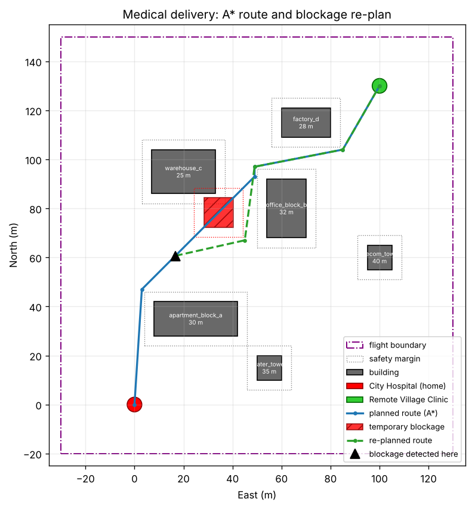
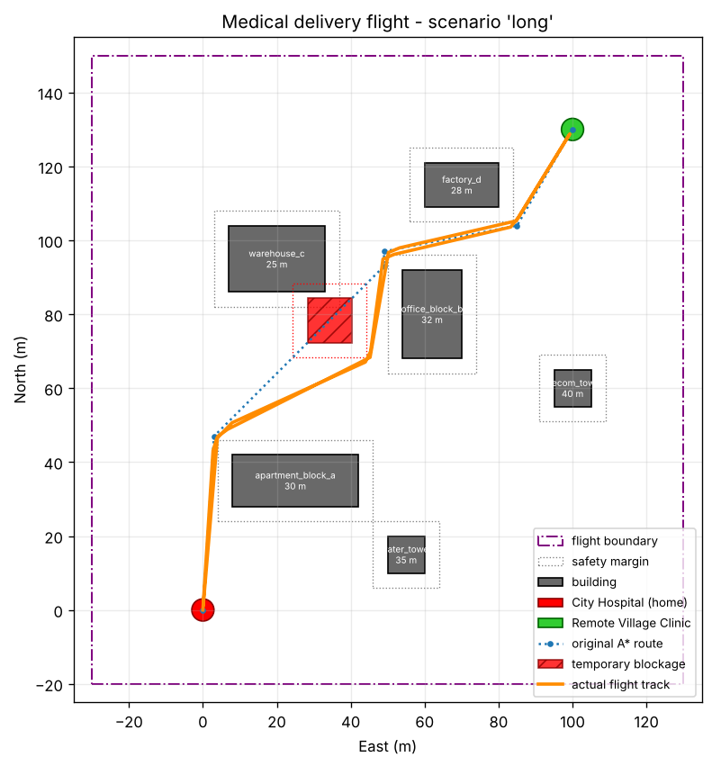

**M.Tech (CSE), I Year · July 2026 · Assignment (20 marks)**

## 1. Team details
| Roll No. | Name |
|---|---|
| 206126035 | TODO: name |
| 206126033 | TODO: name |
| 206126034 | Sriram |

## 2. Question number and problem statement
**Question 8.** *Simulate a drone delivering a medical package to a remote location while avoiding obstacles and handling a temporary route blockage.*

## 3. Design

### 3.1 Scenario
A delivery quadcopter is based at a **City Hospital**, which is its home at (0 m N, 0 m E). It must carry a medical package to a **Remote Village Clinic** at (130 m N, 100 m E) and come back. Between the two sites are six buildings and towers, 25–40 m tall. The drone cruises at 15 m, so it has to fly **around** them.

During the outbound flight, a **temporary blockage** appears on the planned route: a 12 m × 12 m × 30 m structure standing for a crane, a fallen tree or a temporary no-fly zone. The drone has to detect it and deal with it.

Safety boundaries:

- a 160 m × 170 m planning area
- an ArduPilot geofence: a 220 m circle and a 50 m maximum altitude
- RTL altitude above all buildings

{width=85%}

### 3.2 System architecture
```
config/mission.json  (map, obstacles, blockage, speed, fence)
   |                         |
   v                         v
generate_world.py         planner.py (grid + A* + simplify)
   |                         |
   v                         v
Gazebo world  <-- gz -->  mission.py (state machine)
   ^                         |  MAVLink (pymavlink)
   | JSON/UDP                v
   +---- ardupilot_gazebo -- ArduPilot SITL (ArduCopter)
                             |  MAVLink (UDP 14550)
                             v
                          QGroundControl

mission.py --> logs/state.json --> live_map.py
```
How the parts connect:

- **Gazebo** simulates the physics and the iris quadcopter.
- **ArduPilot SITL** runs the real ArduCopter flight-controller firmware. It exchanges sensor data and motor outputs with Gazebo through the `ardupilot_gazebo` plugin, using JSON over UDP.
- **The mission computer** (`mission.py`) commands the flight controller over **MAVLink**, the same way a companion computer or ground station would on a real drone.

### 3.3 Global path planning (pre-flight)

1. **Occupancy grid:** 1 m resolution over the flight boundary.
2. **Obstacle inflation:** every building footprint is grown by a **4 m safety margin**. This is the configuration-space idea: treat the drone as a point and grow the obstacles instead, which also covers position error and braking overshoot.
3. **A\* search:** an 8-connected grid with step costs 1 and √2. It uses the **octile-distance** heuristic, which is admissible, so the result is optimal. Diagonal moves may not cut obstacle corners.
4. **Path simplification:** greedy line-of-sight shortcutting turns the ~180 grid cells into about 5 straight legs.
5. **Execution:** each waypoint is sent to ArduPilot in GUIDED mode with `SET_POSITION_TARGET_LOCAL_NED`, at 6 m/s (`WPNAV_SPEED`).

### 3.4 Handling the temporary blockage (dynamic local re-planning)
This follows the Unit 3 principle: *a pre-flight optimal reference trajectory, plus dynamic local trajectory optimisation when unknown or dynamic threats appear in flight.*

- **Detection:** a simulated forward-looking range sensor with a 25 m range. At every control tick (10 Hz), the remaining route is sampled up to 25 m ahead of the drone. If it enters the blockage (plus margin), the blockage is detected.
- **Reaction:** the drone immediately **holds position**.
- **Decision:** because the obstruction is *temporary*, the drone **waits up to 20 s**:
  - **If it clears in time,** the drone **resumes** the original, shortest route.
  - **If not,** the drone **re-plans with A\*** from its current position, with the blockage added as an obstacle, and flies the detour.
  - **If no detour exists,** the drone aborts and returns home.

  This trades a bounded wait against a longer detour, which costs distance and energy.

- **Return leg:** planned with what the drone has learned. The blockage is avoided if it is still there.

Two test scenarios show both branches:

- `short`: the blockage clears 8 s after detection, so the drone resumes.
- `long`: it is still there after 60 s, so the drone re-plans.

### 3.5 Mission state machine
```
PREFLIGHT -> TAKEOFF -> FOLLOW_PATH
FOLLOW_PATH --blockage within 25 m--> HOLD
HOLD --cleared before 20 s--> FOLLOW_PATH (resume)
HOLD --still blocked at 20 s--> REPLAN -> FOLLOW_PATH
FOLLOW_PATH (at village) -> LAND -> DELIVERED
DELIVERED -> TAKEOFF -> FOLLOW_PATH (return)
FOLLOW_PATH (at hospital) -> LAND -> COMPLETE
any error / Ctrl+C -> RTL at 45 m
```

### 3.6 Safety and flight boundaries
| Mechanism | Setting | Purpose |
|---|---|---|
| Planner boundary | 160 m × 170 m area | Routes never leave the predefined area |
| Safety margin | 4 m around every obstacle | Clearance for drone size and tracking error |
| Geofence | `FENCE_TYPE=3`, `FENCE_RADIUS=220`, `FENCE_ALT_MAX=50`, `FENCE_ACTION=1` | Hard limit enforced by the flight controller; a breach triggers RTL |
| RTL altitude | `RTL_ALT=4500` (45 m) | A failsafe return flies above the tallest building (40 m) |
| Error handling | Exception or Ctrl+C triggers RTL | The vehicle is never left without a command |

## 4. Tools used
| Tool | Version | Purpose |
|---|---|---|
| ArduPilot SITL (ArduCopter) | master (Nov 2026) | Flight-controller firmware in simulation |
| Gazebo Harmonic + `ardupilot_gazebo` | gz-sim 8 | 3D physics world and quadcopter model |
| QGroundControl | 5.0.8 | Ground-control station: map, telemetry |
| MAVProxy | from ArduPilot | MAVLink router and SITL console |
| Python 3 + `pymavlink` | 3.10 | Mission control over MAVLink |
| `matplotlib` | 3.5+ | Live mission map and result plots |
| ROS2 Humble + `ros_gz` bridge | Humble | Installed per the course guide; available for sensor extensions such as a Gazebo lidar |

## 5. Environment / platform
| Item | Details |
|---|---|
| Host | Windows 11 laptop: Intel i7-9750H, 24 GB RAM, NVIDIA GTX 1660 Ti |
| Guest | Ubuntu 22.04.5 LTS in VMware Workstation Pro (13 GB RAM, 8 vCPU, 3D acceleration on, OpenGL 4.3 via SVGA3D) |
| Gazebo rendering | `--render-engine ogre`, which is stable in the VM |
| Simulated location | ArduPilot default home (CMAC, Canberra); the mission works in local NED metres from the hospital |

## 6. Procedure for execution
The full step-by-step procedure, including installation and troubleshooting, is in `README.md` and `docs/SETUP_GUIDE.md`. In short:
```
cd ~/Drone && ./scripts/run_all.sh long      # or: short / none
```
This opens four terminals:

1. Gazebo: `worlds/medical_delivery.sdf`
2. ArduPilot SITL, connected to Gazebo
3. Live map: `scripts/live_map.py`
4. Mission: `scripts/mission.py --scenario long`

Results are written to `logs/`: `flight_map.png`, `flight_log.csv` and `events.txt`.

## 7. Results

### 7.1 Re-plan scenario (`long`)
{width=75%}

Event timeline (offline logic test, kinematic drone model):

| Time | Event |
|---|---|
| 8.8 s | Blockage detected 24.7 m ahead at (78 N, 34 E); holding position |
| 28.9 s | Still blocked after 20 s; re-planning with A\* |
| 28.9 s | New route: 4 legs, 138 m |
| 61.3 s | Package delivered to Remote Village Clinic |
| 107.2 s | Mission complete: 371 m flown, 20 s waiting, 1 re-plan |

### 7.2 Summary of all scenarios
| Scenario | Distance flown | Waiting at blockage | Re-plans | Outcome |
|---|---|---|---|---|
| none | 356 m | 0 s | 0 | Delivered and returned |
| short | 357 m | 8 s | 0 | Waited, blockage cleared, resumed original route |
| long | 371 m | 20 s | 1 | Waited, still blocked, re-planned detour |

The numbers come from `tests/test_mission.py`, which runs the full mission logic against a simulated drone. In the SITL + Gazebo runs, the drone follows the same routes. Add `logs/flight_map.png` and a Gazebo screenshot from your own run here.

## 8. Conclusion
The simulation shows an autonomous medical delivery that:

1. plans a collision-free route around known obstacles with A\*,
2. detects an unexpected blockage on that route in flight,
3. chooses between waiting and re-routing according to how long the blockage lasts,
4. delivers the package and returns safely,
5. stays within a geofence with failsafe RTL.

Possible extensions:

- a real Gazebo lidar via ROS2 in place of the simulated range sensor
- moving obstacles
- battery-aware route choice
- a payload gripper (`MAV_CMD_DO_GRIPPER`)

## 9. Contribution of each member
| Roll No. | Name | Contribution |
|---|---|---|
| 206126035 | TODO | TODO: describe what this member actually did |
| 206126033 | TODO | TODO: describe what this member actually did |
| 206126034 | Sriram | TODO: describe what you actually did |
